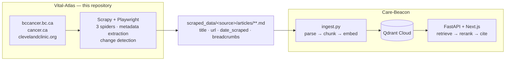

# Vital Atlas - Cancer Health Info Web Scraper

A web scraping application that crawls and extracts health information articles from cancer information websites, converting them to clean Markdown format for use in RAG (Retrieval-Augmented Generation) pipelines.

**Downstream consumer:** [Care-Beacon](https://github.com/kamlau024/Care-Beacon) is the
RAG system this scraper feeds — it ingests the Markdown produced here and serves cited
answers to patient questions at https://care-beacon-health.vercel.app. See
[Use with RAG Pipeline](#use-with-rag-pipeline) for how the two fit together.

## Supported Data Sources

- **BC Cancer** (bccancer.bc.ca) - BC Cancer Agency health information
- **Canadian Cancer Society** (cancer.ca) - Comprehensive cancer information, treatments, and living with cancer resources
- **Cleveland Clinic** (clevelandclinic.org) - Disease and condition articles covering symptoms, diagnosis and treatment

Each source has its own spider and its own metadata extractor, because the three sites
differ in markup, in navigation structure, and in how much content they hide behind
interactive elements.

## How a crawl works

<picture>
  <source media="(prefers-color-scheme: dark)" srcset="docs/diagrams/architecture.dark.svg">
  
</picture>

- **One spider per crawl.** `scrapy crawl <spider>` (or `run_<source>.sh`) runs one of the three spiders, which writes to its own `scraped_data/<source>/`.
- **Pages are rendered in headless Chromium** via `scrapy-playwright`, so content built by JavaScript is captured. Each source is discovered differently: BC Cancer by following `/health-info` links, cancer.ca by rendering its three sections and scrolling A–Z lists ([see below](#virtualized-list-handling)), and Cleveland Clinic through its A–Z index, which returns article URLs as JSON for each letter.
- **Three pipeline stages** turn each page into a file: metadata (extracted in the spider), HTML → Markdown with a per-source converter, then storage with [change detection](#change-detection).

Diagram sources and interactive versions are in [`docs/diagrams/`](docs/diagrams/).

## Features

- **Multi-Source Crawling**: Scrapes from multiple authoritative cancer information websites
- **Targeted Scraping**: Start from any specific URL to scrape individual pages or sections
- **Markdown Conversion**: Converts HTML to clean Markdown while preserving document structure
- **Toggle-Tip Processing**: Extracts and formats glossary definitions from interactive elements
- **Virtualized List Handling**: Incremental scrolling strategy captures all items from dynamically-loaded lists
- **Metadata Extraction**: Captures URLs, dates, breadcrumbs, sidebar links, images, and more
- **Change Detection**: Tracks new and updated articles across scraping runs
- **JavaScript Support**: Uses Playwright to render JavaScript-heavy pages
- **Smart Content Filtering**: Removes navigation, ads, ratings, and other non-content elements
- **Respectful Scraping**: Implements rate limiting and follows robots.txt

## Project Structure

```
Vital-Atlas/
├── vital_atlas/               # Main Scrapy project
│   ├── scrapy.cfg            # Scrapy configuration
│   ├── tests/                # pytest suite (pipelines, HTML→Markdown)
│   └── vital_atlas/
│       ├── spiders/
│       │   ├── bc_cancer_spider.py           # BC Cancer spider
│       │   ├── canadian_cancer_society_spider.py  # CCS spider
│       │   └── cleveland_clinic_spider.py    # Cleveland Clinic spider
│       ├── items.py          # Data structures
│       ├── middlewares.py    # Scrapy middleware template (not enabled)
│       ├── pipelines.py      # Data processing pipelines
│       ├── settings.py       # Scrapy settings
│       └── utils/            # Utility modules
│           ├── html_to_markdown.py        # HTML→Markdown converter
│           ├── ccs_html_to_markdown.py    # CCS-specific converter
│           ├── change_detector.py         # New/updated article detection
│           ├── bc_cancer_metadata_extractor.py   # BC Cancer metadata
│           ├── ccs_metadata_extractor.py  # CCS metadata
│           └── cleveland_clinic_metadata_extractor.py  # Cleveland Clinic metadata
├── scraped_data/            # Output directory (created on first run)
│   ├── bc-cancer/
│   │   ├── articles/        # BC Cancer markdown files
│   │   └── metadata/        # BC Cancer JSON metadata
│   ├── canadian-cancer-society/
│   │   ├── articles/        # CCS markdown files
│   │   └── metadata/        # CCS JSON metadata
│   └── cleveland-clinic/
│       ├── articles/        # Cleveland Clinic markdown files
│       └── metadata/        # Cleveland Clinic JSON metadata
├── run_bc_cancer.sh         # Convenience script for BC Cancer
├── run_canadian_cancer_society.sh  # Convenience script for CCS
├── run_cleveland_clinic.sh  # Convenience script for Cleveland Clinic
├── environment.yml          # Conda environment specification
└── Claude.md               # Project context for Claude

```

## Setup

<details>
<summary>Conda environment, Playwright browsers, and verification</summary>

### 1. Create and Activate Conda Environment

```bash
conda env create -f environment.yml
conda activate vital-atlas
```

### 2. Install Playwright Browsers

Playwright requires browser binaries to be installed:

```bash
playwright install chromium
```

### 3. Verify Installation

```bash
cd vital_atlas
scrapy list
```

You should see `bc_cancer`, `canadian_cancer_society`, and `cleveland_clinic` in the output.

</details>

## Usage

<details>
<summary>Run commands: convenience scripts and Scrapy</summary>

### Quick Start with Convenience Scripts

**BC Cancer scraper:**
```bash
# Scrape entire BC Cancer health-info section
./run_bc_cancer.sh

# Scrape a specific page or section
./run_bc_cancer.sh https://www.bccancer.bc.ca/health-info/types-of-cancer/breast

# With Scrapy options
./run_bc_cancer.sh -s CLOSESPIDER_ITEMCOUNT=10 -s LOG_LEVEL=INFO
```

**Canadian Cancer Society scraper:**
```bash
# Scrape entire CCS site (cancer-information, treatments, living-with-cancer)
./run_canadian_cancer_society.sh

# Scrape a specific page
./run_canadian_cancer_society.sh https://cancer.ca/en/cancer-information/resources/glossary/w/wart

# Scrape from a specific section
./run_canadian_cancer_society.sh https://cancer.ca/en/treatments -s CLOSESPIDER_ITEMCOUNT=100
```

**Cleveland Clinic scraper:**
```bash
# Scrape the full A–Z health library
./run_cleveland_clinic.sh

# Scrape a specific article
./run_cleveland_clinic.sh https://my.clevelandclinic.org/health/diseases/15548-c-diff-infection
```

### Running Directly with Scrapy

From the `vital_atlas` directory:

```bash
# BC Cancer
scrapy crawl bc_cancer

# Canadian Cancer Society
scrapy crawl canadian_cancer_society

# Cleveland Clinic
scrapy crawl cleveland_clinic

# With custom URL
scrapy crawl canadian_cancer_society -a url=https://cancer.ca/en/cancer-information/resources/glossary

# With custom settings
scrapy crawl bc_cancer -s DOWNLOAD_DELAY=3 -s LOG_LEVEL=INFO
```

</details>

### Output Structure

Scraped articles are saved in `scraped_data/`:

```
scraped_data/
├── bc-cancer/
│   ├── articles/
│   │   └── health-info/
│   │       ├── types-of-cancer/
│   │       │   ├── breast-cancer.md
│   │       │   └── ...
│   │       └── coping-with-cancer/
│   │           └── ...
│   └── metadata/
│       ├── breast-cancer.json
│       ├── url_index.json
│       └── change_log.json
└── canadian-cancer-society/
    ├── articles/
    │   ├── en/
    │   │   ├── cancer-information/
    │   │   │   ├── cancer-types/
    │   │   │   └── resources/
    │   │   │       └── glossary/
    │   │   │           ├── a/
    │   │   │           ├── b/
    │   │   │           └── ...
    │   │   ├── treatments/
    │   │   └── living-with-cancer/
    │   └── ...
    └── metadata/
        ├── url_index.json
        └── change_log.json
```

`cleveland-clinic/` follows the same `articles/` + `metadata/` layout.

### Markdown File Format

Each article is saved as a Markdown file with YAML frontmatter:

```markdown
---
title: "wart"
url: https://cancer.ca/en/cancer-information/resources/glossary/w/wart
date_scraped: 2025-11-09T17:46:39.393946
breadcrumbs:
  - Cancer Information
  - Resources
  - Glossary
  - W
  - Wart
---

# wart

## Description

A non-cancerous (benign) growth on the skin or a mucous membrane caused by human papillomavirus (HPV).

Compare with papilloma.

* * *

**mucous membrane:**

The thin, moist layer of tissue that lines some organs and body cavities...

**human papillomavirus (HPV):**

A type of virus that causes abnormal tissue growth (warts)...
```

## Advanced Features

### Toggle-Tip Processing

The Canadian Cancer Society spider automatically processes interactive glossary terms:
- Extracts term definitions from popup/modal content
- Keeps terms inline in the main text
- Appends formatted definitions at the end of the article
- Preserves proper text flow without unwanted line breaks

### Virtualized List Handling

<picture>
  <source media="(prefers-color-scheme: dark)" srcset="docs/diagrams/scroll-capture.dark.svg">
  
</picture>

For pages with dynamically-loaded content (like the glossary index):
- Uses incremental scrolling to capture all items
- Scrolls 500px at a time, capturing new links at each position
- Handles lists that recycle DOM elements (only ~40 items visible at once)
- Stops after 5 scrolls in a row add no new links, or after 100 scrolls
- Successfully captures 1,100+ glossary entries from A-Z

### Smart Content Filtering

Automatically removes non-content elements:
- Navigation menus and breadcrumbs
- Fundraising/donation blocks
- Newsletter signup forms
- Page rating widgets (Qualtrics)
- Print buttons and utility controls

## Change Detection

<picture>
  <source media="(prefers-color-scheme: dark)" srcset="docs/diagrams/change-detection.dark.svg">
  
</picture>

The scraper automatically tracks changes between runs:

- **New Articles**: URLs not yet in `url_index.json` are logged as new
- **Updated Content**: Changes to article content are detected via an MD5 hash of the Markdown
- **Metadata Changes**: A changed title, last-update date, or next-review date also counts as an update
- **Unchanged Articles**: Still rewritten on every crawl, but nothing is logged for them

View recent changes in `scraped_data/[source]/metadata/change_log.json`, which keeps the most recent 1,000 new or updated events.

## Configuration

Key settings in `vital_atlas/vital_atlas/settings.py`, some overridden per spider in `custom_settings`:

- `DOWNLOAD_DELAY`: Time between requests (2 seconds by default; 1 second for CCS and Cleveland Clinic)
- `CONCURRENT_REQUESTS`: Max concurrent requests (8 by default; 4 for CCS, 3 for Cleveland Clinic)
- `ROBOTSTXT_OBEY`: Respect robots.txt (default: True)
- `PLAYWRIGHT_MAX_PAGES_PER_CONTEXT`: Max pages per browser context (5 for CCS, 3 for Cleveland Clinic)
- `HTTPCACHE_ENABLED`: Enable HTTP cache (on by default; off for CCS and Cleveland Clinic so Playwright pages load fresh)

## Use with RAG Pipeline

The scraped Markdown files are optimized for RAG pipelines:

1. **Structured Content**: Clear hierarchy with headings and sections
2. **Rich Metadata**: Frontmatter includes all contextual information
3. **Clean Formatting**: Minimal noise, maximum signal
4. **Inline Definitions**: Glossary terms flow naturally in text with definitions appended
5. **Change Tracking**: `change_log.json` lists new and updated articles, so a consumer can re-ingest only those

### Care-Beacon, the reference consumer

[Care-Beacon](https://github.com/kamlau024/Care-Beacon) is the RAG system built on this
scraper's output, live at https://care-beacon-health.vercel.app. The two repositories
form one pipeline with a deliberate split: Vital-Atlas owns acquisition and
normalisation, Care-Beacon owns retrieval and generation.



The entire contract between them is the Markdown file and its frontmatter schema —
nothing more. That is what let Care-Beacon change hosting providers, replace its vector
store and delete a 272 MB keyword index without a single change to this repository.

**The hand-off is manual.** This scraper writes to its own `scraped_data/`; those files
are copied into Care-Beacon and ingested there. Nothing reconciles the two sides, so
articles scraped here are not live until that copy happens.

### Loading the output directly

Example integration with LangChain:

```python
from langchain.document_loaders import DirectoryLoader, UnstructuredMarkdownLoader

# Load BC Cancer articles
bc_loader = DirectoryLoader(
    'scraped_data/bc-cancer/articles/',
    glob="**/*.md",
    loader_cls=UnstructuredMarkdownLoader
)

# Load CCS articles
ccs_loader = DirectoryLoader(
    'scraped_data/canadian-cancer-society/articles/',
    glob="**/*.md",
    loader_cls=UnstructuredMarkdownLoader
)

# Load Cleveland Clinic articles
cc_loader = DirectoryLoader(
    'scraped_data/cleveland-clinic/articles/',
    glob="**/*.md",
    loader_cls=UnstructuredMarkdownLoader
)

documents = bc_loader.load() + ccs_loader.load() + cc_loader.load()
```

## Troubleshooting

<details>
<summary>Playwright, timeouts, virtualized lists, and permissions</summary>

### Playwright Issues

If Playwright fails to launch browsers:

```bash
playwright install chromium
```

### Timeout Errors

If pages timeout while loading, the spiders use `domcontentloaded` instead of `networkidle` for faster, more reliable loading. This is already configured.

### Virtualized Lists Not Fully Captured

The incremental scrolling strategy should capture all items. Check logs for:
```
INFO: Scroll X: Found Y new links (total: Z)
INFO: Captured N total links from alphabetical list
```

### Permission Errors

Ensure the output directory is writable:

```bash
chmod -R 755 scraped_data/
```

</details>

## Development

### Running Tests

```bash
cd vital_atlas
pytest tests/ -v
```

### Testing Specific Pages

```bash
# Test a single page
./run_canadian_cancer_society.sh https://cancer.ca/en/cancer-information/resources/glossary/w/wart -s CLOSESPIDER_ITEMCOUNT=1

# Test toggle-tip processing
./run_canadian_cancer_society.sh https://cancer.ca/en/cancer-information/cancer-types/bone/treatment/chondrosarcoma -s CLOSESPIDER_ITEMCOUNT=1

# Test alphabetical list scrolling
./run_canadian_cancer_society.sh https://cancer.ca/en/cancer-information/resources/glossary -s CLOSESPIDER_ITEMCOUNT=100
```

## License

This project is for educational and research purposes. Please respect the terms of service and robots.txt of the source websites when scraping.

## Contributing

Contributions are welcome! Please ensure all clarification questions are addressed before implementing features.
